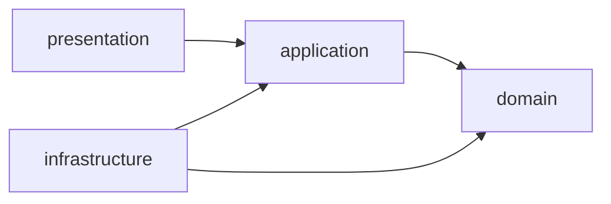

# Clean Architecture — Restaurant API (Fase 2)

Este documento descreve como organizar o código deste repositório segundo Clean Architecture, alinhado ao Tech Challenge (separação Domain / Application / Infrastructure / Presentation).

## Objetivo

Isolar as **regras de negócio** de detalhes de framework (Spring, JPA, HTTP), para que o domínio seja testável e evolua sem acoplar a tecnologias externas.

## Camadas

```
com.api.restaurant
├── domain/           # Núcleo: entidades, VOs, ports
├── application/      # Casos de uso / orquestração
├── infrastructure/   # Adapters técnicos (JPA, Security, config)
└── presentation/     # Adapters de entrada HTTP
```

### Domain

- Modelos de negócio (`User`, `Restaurant`, `MenuItem`, etc.).
- Enums de domínio (`UserTypeCategory`, `DayOfWeek`, …).
- **Ports** (interfaces) para persistência e outros gateways.
- **Não** depende de Spring Data, Jakarta Persistence em anotações de framework preferencialmente evitadas no domínio puro; neste projeto, se entidades JPA ficarem em `infrastructure.persistence`, o domain expõe modelos ricos + ports. Na prática adotada aqui: modelos de domínio em `domain.model` sem anotações JPA; mapeamento nas entidades/adapters de `infrastructure`.

### Application

- Services / use cases que implementam fluxos (CRUD + regras: bloqueio de troca de tipo, validação de staff no dono, cascade conceitual via serviço, etc.).
- Recebe e devolve DTOs de aplicação ou modelos de domínio — **não** `HttpServletRequest` / anotações Web.

### Infrastructure

- Implementações dos ports (repositórios Spring Data JPA).
- Configuração (`SecurityConfig`, OpenAPI, datasource).
- Entidades JPA e mappers domain ↔ persistence, se separados.

### Presentation

- Controllers REST sob `/api/v1`.
- DTOs de request/response e validação Bean Validation na borda.
- `GlobalExceptionHandler` com **ProblemDetail (RFC 7807)**.

## Regra de dependência



- Setas apontam para o que a camada **pode importar**.
- O `domain` não importa ninguém.
- Controllers nunca chamam repositórios JPA diretamente.

## Exemplos

### Permitido

- `RestaurantService` (application) chama `RestaurantRepository` (port em domain).
- `JpaRestaurantRepository` (infrastructure) implementa o port e usa `RestaurantJpaEntity`.
- `RestaurantController` chama `RestaurantService` e mapeia para `RestaurantResponse`.

### Proibido

- `RestaurantController` injetar `RestaurantJpaRepository`.
- Classe em `domain` com `@RestController` ou `@SpringBootApplication`.
- Retornar `@Entity` JPA no body da API.

## Checklist de PR / revisão

- [ ] Nova regra de negócio está em `domain` ou `application`, não no controller.
- [ ] Novas dependências de framework ficam em `infrastructure` ou `presentation`.
- [ ] Ports atualizados se a persistência mudou.
- [ ] DTOs HTTP não vazam para o domain.
- [ ] Testes unitários cobrem o use case sem subir o servidor (quando aplicável).

## Referência rápida de pacotes

| Precisa de… | Coloque em… |
|---|---|
| Regra “dono deve ser RESTAURANT_STAFF” | `application` (e/ou método de domínio) |
| Interface `save` / `findById` | `domain.port` |
| `@Entity` + `@Table` | `infrastructure.persistence` |
| `@RestController` | `presentation.controller` |
| `PasswordEncoder` / Security filter chain | `infrastructure.config` |
